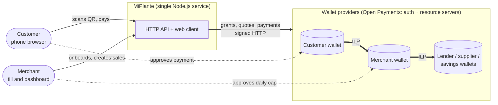
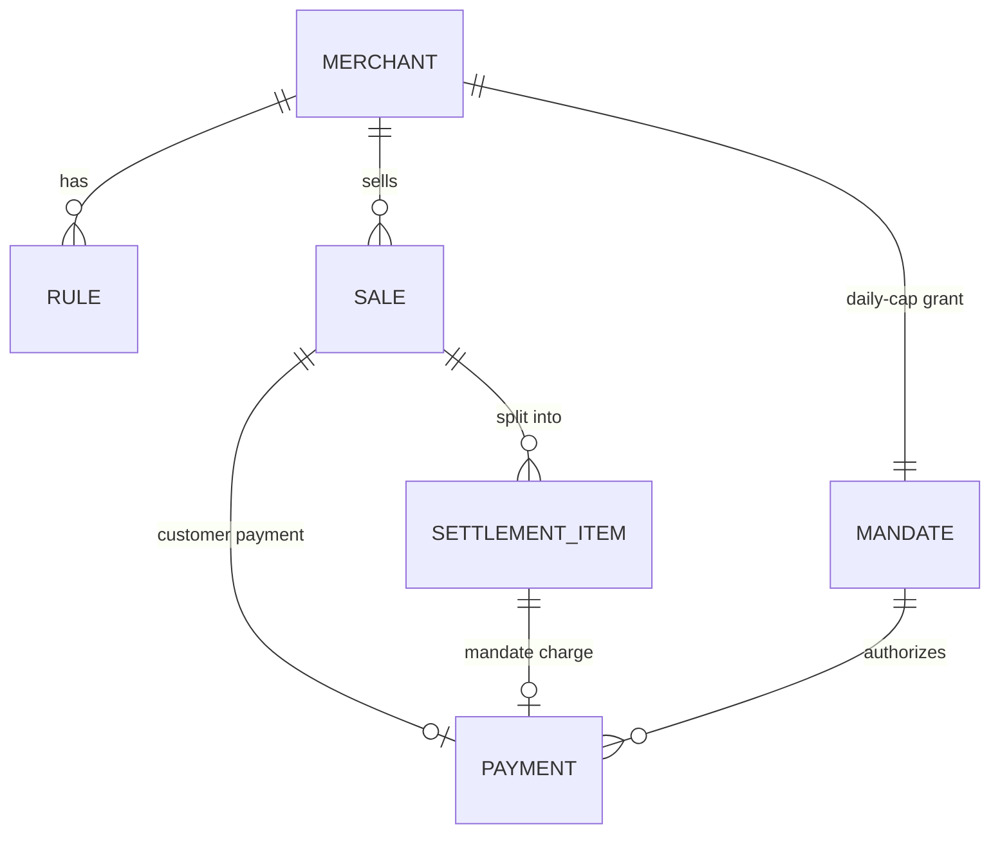
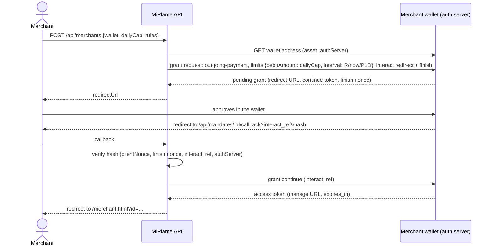
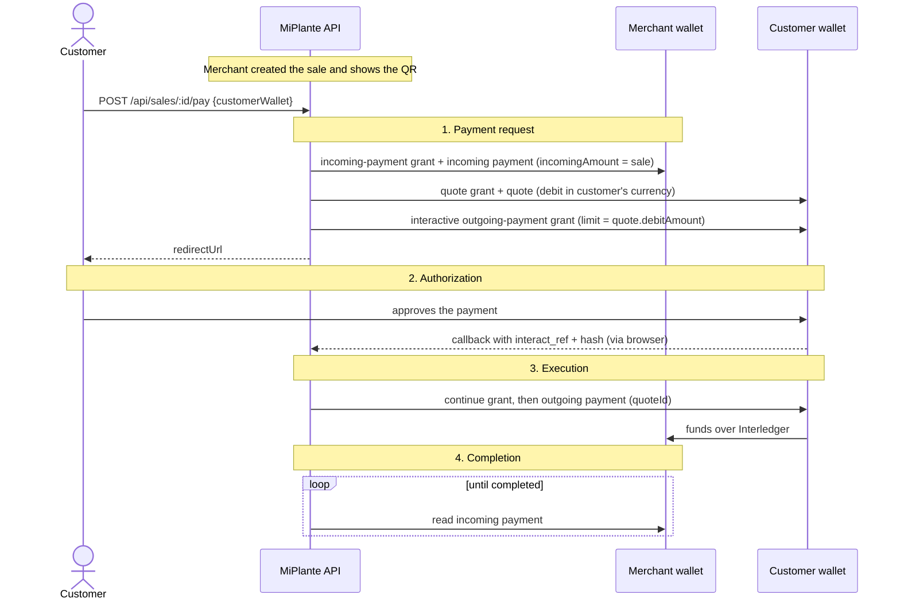
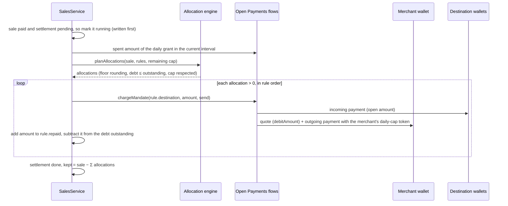

# MiPlante system design

## 1. Goal

Split every sale a micro-merchant receives into the merchant's own profit and a set of obligations
(supplier credit, microcredit, savings), in real time and in proportion to the sale. All money moves
through Open Payments, and is capped by a daily limit the merchant approved once in their own wallet.

Product context: [`product/PRODUCT_BRIEF.md`](product/PRODUCT_BRIEF.md). Decisions:
[`adr/`](adr/README.md).

## 2. Requirements

### Functional

| ID  | Requirement                                                                                                                                  |
| --- | -------------------------------------------------------------------------------------------------------------------------------------------- |
| F1  | A merchant registers their wallet, a daily cap and 1–5 rules: debt rules (share + outstanding balance) or savings rules (share).             |
| F2  | The merchant approves a single Open Payments grant: outgoing payments from their wallet up to the daily cap per day.                         |
| F3  | The merchant creates a sale for an amount and gets a link and QR code for the customer.                                                      |
| F4  | The customer pays the sale from their own wallet, approving it in their wallet (payment request → authorization → execution → completion).   |
| F5  | When the payment completes, the sale is split by the rules: one outgoing payment per rule from the merchant's wallet. Debt balances go down. |
| F6  | The merchant sees today's sales and split, debt progress, savings, the cap spent today and a seven-day income history.                       |
| F7  | A developer sandbox exposes the raw flows: one-off payments, recurring grants, charges and splits.                                           |

### Non-functional

| ID  | Requirement                                                                                                                                      |
| --- | ------------------------------------------------------------------------------------------------------------------------------------------------ |
| N1  | **Consent.** No money leaves a wallet without a grant its owner approved in their wallet.                                                        |
| N2  | **Safety cap.** The merchant can never be debited more than the daily cap, even if our code is wrong.                                            |
| N3  | **Exact money.** Integer arithmetic only; the parts of a split add up exactly to the sale.                                                       |
| N4  | **Exactly-once settlement.** A sale is split once, even with concurrent polls, reloads or restarts.                                              |
| N5  | **Security.** Tokens and nonces never leave the server; callbacks are verified; only allow-listed wallet hosts are called; inputs are validated. |
| N6  | **Demo reliability.** Runs on one laptop with `npm run dev`; state survives restarts.                                                            |

## 3. Context



MiPlante never holds money. Funds move between wallets over Interledger, and MiPlante only creates
and tracks Open Payments resources with grants the wallet owners approved.

## 4. Components

```mermaid
flowchart TB
  web[public/: onboarding, till, checkout, sandbox] --> http
  http[http/: Express routes + zod schemas] --> merchants
  http --> flows
  merchants[merchants/: MerchantService, SalesService, sweeper] --> domain
  merchants --> flows
  merchants --> storage
  domain[domain/: allocation engine, calendar] --> shared
  flows[openPayments/flows: one-off payments, mandates, charges] --> ops
  flows --> storage
  ops[openPayments/operations: one call per Open Payments step] --> sdk[(@interledger/open-payments)]
  storage[storage/: JSON store] --> shared[shared/: money, errors]
```

| Module          | Responsibility                                                                                                                                  |
| --------------- | ----------------------------------------------------------------------------------------------------------------------------------------------- |
| `shared/`       | `Amount` math on BigInt minor units; application errors with HTTP status.                                                                       |
| `domain/`       | Pure rules: `planAllocations` (who gets what from a sale), rule validation, Bogotá calendar days.                                               |
| `merchants/`    | Use cases: onboarding, sales, settlement, dashboard, background sweeper.                                                                        |
| `openPayments/` | The adapter: wallet discovery, grants, quotes, incoming/outgoing payments, hash verification, token rotation. It knows nothing about merchants. |
| `storage/`      | `Store`: payments, mandates, merchants and sales, persisted to `data/store.json`.                                                               |
| `http/`         | REST API, input validation, error mapping, consent callbacks.                                                                                   |
| `public/`       | Spanish, mobile-first static pages that only use the public API.                                                                                |

## 5. Data model



| Record                            | Key fields                                                                                                                                      |
| --------------------------------- | ----------------------------------------------------------------------------------------------------------------------------------------------- |
| **Merchant**                      | `id`, `name`, `wallet`, `asset` (code + scale), `dailyCap`, `rules[]`, `mandateId`                                                              |
| **Rule**                          | `id`, `label`, `kind` (`debt` \| `savings`), `destination` wallet, `shareBps`, `outstanding` (debt), `repaid`                                   |
| **Sale**                          | `id`, `merchantId`, `amount`, `status` (`open` → `awaiting-consent` → `processing` → `paid` \| `failed`), `paymentId`, `customer`, `settlement` |
| **Settlement**                    | `status` (`pending` → `running` → `done` \| `skipped`), `items[]` (rule, amount, status, `capped`, `paymentId`), `kept`                         |
| **Payment** (Open Payments layer) | incoming/outgoing payment URLs, quote, amounts, status, the four demo `steps`; tokens kept server-side                                          |
| **Mandate** (Open Payments layer) | sender, `maxAmount`, `interval`, status; token and continuation kept server-side                                                                |

## 6. Key flows

### 6.1 Onboarding: one consent with a daily cap



### 6.2 Sale: the four steps the demo must show



If the quote expires while the customer is approving, the API quotes again and continues only if the
new cost is within what the customer approved.

### 6.3 Settlement: the sale splits itself



## 7. Open Payments usage

| Step                 | Resource or grant                                                                   | Interaction                         | Where                                    |
| -------------------- | ----------------------------------------------------------------------------------- | ----------------------------------- | ---------------------------------------- |
| Discover a wallet    | Wallet address (`GET`)                                                              | none                                | `operations.getWalletAddress`            |
| Payment request      | `incoming-payment` grant (create, read) + incoming payment                          | non-interactive                     | `operations.createIncomingPayment`       |
| Price it             | `quote` grant + quote                                                               | non-interactive                     | `operations.createQuote`                 |
| Customer consent     | `outgoing-payment` grant, `limits.debitAmount` = quote                              | **interactive** (redirect + finish) | `flows.startPayment` / `completePayment` |
| Merchant's daily cap | `outgoing-payment` grant, `limits.debitAmount` = cap, `limits.interval` = `R/…/P1D` | **interactive**, once               | `flows.startMandate` / `completeMandate` |
| Execute              | outgoing payment (`quoteId`)                                                        | uses the grant token                | `operations.createOutgoingPayment`       |
| Track                | incoming payment `completed` / `receivedAmount`, outgoing payment `failed`          | —                                   | `flows.refreshPayment`                   |
| Cap spent            | `GET /outgoing-payment-grant` (spent amounts in the current interval)               | —                                   | `operations.getGrantSpentAmounts`        |
| Keep access          | token rotation on expiry or 401; grant cancel on revoke                             | —                                   | `operations.rotateToken` / `cancelGrant` |

## 8. Money rules

Given a sale of `S` minor units and rules `r₁…rₙ` in the merchant's order:

```
allocᵢ = floor(S × shareBpsᵢ / 10,000)
allocᵢ = min(allocᵢ, outstandingᵢ)              debt rules only
allocᵢ = min(allocᵢ, remainingCap)               if the spent amount is known; remainingCap −= allocᵢ
kept   = S − Σ allocᵢ
```

Constraints: shares are whole basis points, and `Σ shareBps ≤ 5,000` (the merchant keeps at least
half). Example: a sale of 10,000.00 COP with rules of 15% and 5% splits into 1,500.00 + 500.00, and
the merchant keeps 8,000.00.

## 9. Consistency and idempotency

- **Callbacks** run only while the record is `awaiting-consent` and clear the interaction once used,
  so a reload cannot continue a grant twice.
- **Settlement** has a persisted state machine (`pending → running → done | skipped`) plus an
  in-process lock per sale. The state is written to `running` before the first payment is created.
- **Debt balances** are reduced when the repayment's outgoing payment is created successfully. If the
  creation fails, the balance is untouched and the item is marked `failed`.
- **Restarts** are safe: records are persisted after every change, and the sweeper picks up any sale
  left in `processing` or `paid` with a pending settlement.

## 10. Security

| Threat                                 | Mitigation                                                                                                                     |
| -------------------------------------- | ------------------------------------------------------------------------------------------------------------------------------ |
| Forged consent callback                | GNAP interaction hash verified with a constant-time comparison; one-shot interactions                                          |
| SSRF through user-supplied wallet URLs | Only hosts in `OP_ALLOWED_WALLET_HOSTS` are called (default `ilp.interledger-test.dev`); `https` only                          |
| Token leakage                          | Tokens, nonces and continuation data are stripped from every API response; `data/` is git-ignored and written with mode `0600` |
| Over-collection                        | Wallet-enforced daily cap (ADR 0004), debt ≤ outstanding, total shares ≤ 50%                                                   |
| Malicious input                        | zod validation on every body and query; JSON limited to 20 kB; amounts validated against the asset scale                       |
| Script injection in the UI             | Server data rendered with `textContent` only                                                                                   |
| Secrets in a public repo               | `private.key`, `*.pem`, `.env*` git-ignored; the key can also come from `OP_PRIVATE_KEY`                                       |

## 11. Failure modes

| Failure                        | Behavior                                                                                             |
| ------------------------------ | ---------------------------------------------------------------------------------------------------- |
| Customer rejects in the wallet | Payment `rejected`, sale `failed`; the customer can try again                                        |
| Quote expired during consent   | Quote again; fail with 409 if the new cost exceeds the approved amount                               |
| Access token expired           | Rotate before expiry and once more on 401                                                            |
| Daily cap reached              | Allocations reduced to the remaining cap; the rest is not collected that day (`capped`)              |
| Cap spent amount unavailable   | Allocate without pre-capping; the wallet still rejects excess debits, so the item is marked `failed` |
| Merchant revoked the grant     | Settlement `skipped` with a reason; sales still reach the merchant                                   |
| Destination wallet missing     | That item `failed`; other items continue                                                             |
| Server restart mid-flow        | Records persisted; the sweeper resumes polling and settlement                                        |

## 12. Limits and path to production

| Today (hackathon)          | Production                                                                                |
| -------------------------- | ----------------------------------------------------------------------------------------- |
| JSON file, single instance | PostgreSQL, tokens encrypted at rest, row-level settlement locks                          |
| Polling every few seconds  | Backoff and batching; provider notifications where available                              |
| Test-network wallets       | Colombian wallet providers adopting Open Payments; cash-in and cash-out at banking agents |
| Rules set by the merchant  | Rules agreed with the lender, with a lender-side portal and reporting                     |
| Seven-day history          | Verifiable, consent-based income passport for formal credit                               |

## 13. Testing strategy

- **Unit:** money math, interaction hash, intervals, wallet address normalization, allocation engine.
- **Flow:** Open Payments flows, merchants and sales against an in-memory fake of `PaymentOperations`
  that records every call (no network).
- **HTTP:** validation, error mapping, token redaction and callback redirects against a real Express
  server on a random port.
- **Manual end-to-end:** the sandbox and the MiPlante screens against the Interledger test wallet
  (see [`OPEN_PAYMENTS.md`](OPEN_PAYMENTS.md)).
